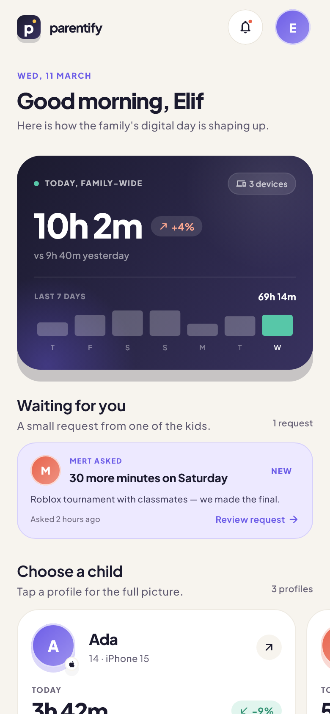
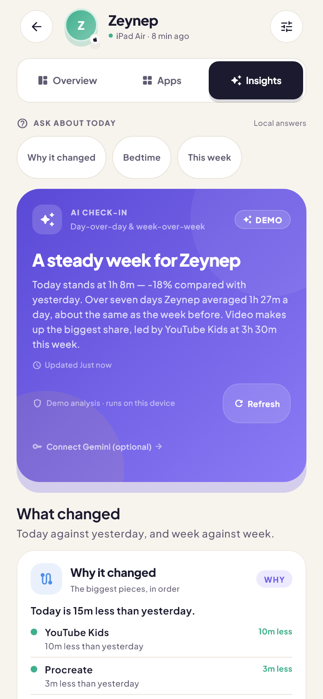

# Parentify

[](https://github.com/keremify/parentify/actions/workflows/ci.yml)
[](https://flutter.dev)
[](https://dart.dev)
[](LICENSE)

A calm, private family screen-time companion and open-source foundation for digital wellbeing.

<p align="center">
  
  &nbsp;&nbsp;&nbsp;&nbsp;
  
</p>
<p align="center">
  <em>Left: Parent Home Dashboard & Agency Requests &nbsp;•&nbsp; Right: Child Insights & Explainable AI Reflection</em>
</p>

Parentify is built around one guiding philosophy: **a family digital wellbeing platform should foster mutual understanding, agency, and communication—not punitive locks, opaque scoring, or invasive surveillance.**

The application runs a complete, simulated **offline-first local architecture** backed by an on-device SQLite database, outbox synchronization queue, clean layered DAOs/repositories, and optional on-device / Gemini AI reflection.

---

## The Three Pillars

Parentify is intentionally different from parent-only restriction dashboards:

1. **Understanding** — context notes, ranked “why it changed” attribution, “show the math” evidence, local question chips, and AI reports that carry weekly notes and check-ins into next week.
2. **Agency** — children can ask for more time with a reason, parents can reply with a context note, agreements are transparent to both sides, and each child has an agreed sharing level.
3. **Ritual** — a weekly family check-in with three cards (notice / ask / try), a saved focus, a streak, and an optional whole-family balance card that includes the parent’s own screen time.

The language remains gentle throughout: no “violation”, “blocked”, or “banned” states. Every insight leads to a constructive conversation the family can share.

---

## Architecture Overview

Parentify is designed with a production-grade **Clean Architecture**:

```
lib/
├── models/                     # Immutable domain entities & JSON contracts
│   ├── agreement.dart          # Family agreements & pacts
│   ├── app_usage.dart          # App categories, daily usage, and metadata
│   ├── check_in_record.dart    # Weekly family reflection check-ins
│   ├── child.dart              # Child profile, device usage, and metrics
│   ├── context_note.dart       # Sticky notes & day context tags
│   ├── sync_entry.dart         # Outbox sync queue records
│   └── user_role.dart          # Parent / Child roles
│
├── backend/
│   ├── database/               # SQLite schema & seeding
│   │   ├── app_database.dart   # Database lifecycle (mobile sqflite & desktop ffi)
│   │   ├── schema.dart         # DDL tables & indexes
│   │   └── seed_data.dart      # Seed test accounts & 14-day history
│   ├── daos/                   # Data Access Objects (SQL queries & mutations)
│   │   ├── child_dao.dart      # Children, apps, usage, and metrics queries
│   │   ├── social_dao.dart     # Agreements, context notes, and check-ins
│   │   ├── sync_queue_dao.dart # Outbox queue persistence & status tracking
│   │   └── user_dao.dart       # User authentication & family metadata
│   ├── repositories/           # SQLite implementations of repository contracts
│   │   ├── sqlite_family_repository.dart
│   │   └── sqlite_social_repository.dart
│   └── services/               # Backend services
│       ├── cloud_sync_service.dart  # Offline-first sync service & simulation
│       └── sqlite_auth_service.dart # Local sandbox auth (demo only, no real backend)
│
├── repositories/               # Abstract repository contracts (domain interfaces)
│   ├── family_repository.dart
│   └── social_repository.dart
│
├── state/
│   └── app_state.dart          # Reactive state management (ChangeNotifier)
│
├── screens/                    # Presentation layer (feature screens)
├── widgets/                    # Reusable atomic UI components
└── theme/                      # Design system tokens, typography, and palettes
```

---

## Offline-First Outbox Synchronization

Parentify is designed to be fully usable offline and easily connected to a remote cloud backend:

1. **Local Mutation First:** Every user action (saving an agreement, logging a context note, changing sharing visibility, recording an app launch) immediately writes to local SQLite tables for instant UI feedback with zero latency.
2. **Outbox Enqueue:** Simultaneously, an idempotent `SyncEntry` is appended to the `sync_queue` table with status `pending`.
3. **Background Sync:** The `CloudSyncService` dequeues pending entries in FIFO order and dispatches them to remote API endpoints. If the device is offline, entries safely accumulate in SQLite and are dispatched once connectivity is restored.
4. **Connecting a Live Cloud Backend:** To connect Supabase, Firebase Firestore, or a custom GraphQL / REST API, simply implement the `CloudSyncService` interface defined in `lib/backend/services/cloud_sync_service.dart` and swap it into `AppState.createFromSqlite(...)`. See [Backend Integration Blueprint](docs/BACKEND_INTEGRATION.md) for complete copy-ready implementation guides and SQL schemas.

---

## Run It Locally

### Requirements
- [Flutter SDK](https://flutter.dev/docs/get-started/install) 3.47+ with [Dart SDK](https://dart.dev/get-dart) 3.13+

```bash
# 1. Clone repository
git clone https://github.com/keremify/parentify.git
cd parentify

# 2. Install dependencies
flutter pub get

# 3. Launch the app
flutter run
```

### Run Contributor Checks in Docker

Docker provides the same Flutter version used by CI. Build the image once:

```bash
docker build -t parentify-dev .
```

Start a shell with the project mounted (PowerShell):

```powershell
docker run --rm -it -v "${PWD}:/workspace" -v /workspace/.dart_tool -w /workspace parentify-dev
```

Then run the usual checks inside the container:

```bash
flutter pub get
dart format --output=none --set-exit-if-changed .
flutter analyze --fatal-infos
flutter test --reporter expanded
```

The `.dart_tool` volume keeps Linux-generated package metadata separate from
your host machine. The container is for checks; use a local Flutter setup to
launch the app on a device or emulator.

---

## Test Accounts & Sign In

The app initializes with seeded sandbox accounts in the local SQLite database. The credentials can be typed in manually or entered using the one-tap demo buttons:

| Role | Test Account Credentials | One-Tap Demo Button |
| --- | --- | --- |
| **Parent** | Email: `parent@parentify.dev`<br>Password: `Parentify2026!` | **Use demo account** |
| **Child** | Name: **Leo** (Age 11)<br>PIN: `2026` | **Use demo PIN** |

These are demo values, not secrets: they are bundled with the app and stored
locally in plain text. The demo sign-in path is available in debug and profile
builds only. Release builds fail closed until a real authentication backend is
wired up, because there is no server to verify a real credential. The whole
family also shares one child PIN in this demo; per-child PINs are a production
follow-up.

The initial seeded family includes Leo with two weeks of realistic usage, per-app breakdowns, hourly activity, and shared family agreements. Release signing
is intentionally left to the distributor: no keystore is committed, so a
`flutter build apk --release` uses the default debug signing key and is not
ready for store distribution.

---

## Optional Gemini AI Integration

Parentify includes a dual-engine AI reflection system:
1. **Deterministic On-Device Analyzer (Default):** Runs transparent, local rules with zero API key required and zero network traffic.
2. **Gemini 2.5 Flash:** Optional. Pass your API key at build time or enter it in the in-app Settings sheet:
   ```bash
   flutter run --dart-define=GEMINI_API_KEY=your_key_here
   ```
   Keys are never written to a bundled config file. Non-secret defaults (model, endpoint, demo credentials) live in the checked-in `assets/env.defaults`.
   The app provides a complete preview of the exact brief sent to the model via the **What Gemini sees** inspection tool. At the **trends** sharing level the brief is totals-only and the model path is skipped entirely; app and session detail stay on-device.

---

## Quality Gates & Verification

Parentify enforces zero-warning static analysis and strict accessibility standards:

```bash
# Verify code formatting
dart format --output=none --set-exit-if-changed .

# Static code analysis (0 errors, 0 warnings, 0 infos)
flutter analyze --fatal-infos

# Run the full test suite
flutter test
```

### Accessibility Standards
- **Contrast Ratios:** All text meets or exceeds WCAG AA standards (4.5:1 minimum contrast).
- **Hit Areas:** All tappable controls and chips enforce a minimum 48x48dp target.
- **Large Text Scaling:** Fully tested and resilient up to 200% system font scaling without text clipping.
- **Assistive Technology:** Every chart and custom widget exposes spoken semantic descriptions.

---

## Contributing

We welcome contributions from developers, designers, and founders who want to build a better future for family technology! Please read [CONTRIBUTING.md](CONTRIBUTING.md) for contribution guidelines, pull request checklists, and architecture standards.

---

## License

Parentify is open-source software licensed under the [MIT License](LICENSE).

The bundled Plus Jakarta Sans font is licensed under the SIL Open Font License
1.1; see [`assets/fonts/OFL.txt`](assets/fonts/OFL.txt).
